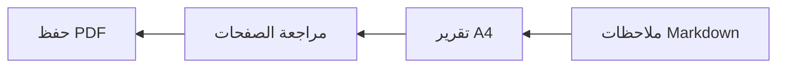

# التقرير الهندسي الأسبوعي

أُعدّ لمراجعة الفريق. يستخدم هذا المثال صفحات A4 ويحافظ على إمكانية تحديد نص المستند ونسخه في PDF.

## تقدّم هذا الأسبوع

- [x] مراجعة قائمة الإصدار
- [x] إكمال التوثيق
- [ ] مشاركة التقرير النهائي

| المجال | الحالة | الخطوة التالية |
| --- | --- | --- |
| التوثيق | جاهز | المراجعة مع الفريق |
| العرض | جاهز | فحص ملف PDF |
| الإصدار | قيد التنفيذ | تأكيد القائمة |

## مسار التسليم



## حساب بسيط

إذا اكتمل $a$ من أصل $b$ من العناصر، فإن نسبة الإنجاز هي:

$$
r = \frac{a}{b}
$$

## مثال على الشيفرة

```javascript
const report = {
  title: "التقرير الهندسي الأسبوعي",
  status: "جاهز للمراجعة"
};
console.log(report.title);
```

> أضف ملاحظاتك إلى هذا المثال، ثم راجع الناتج قبل مشاركته.
